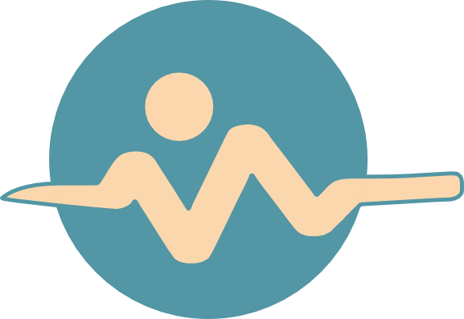

  

<h1 align="center">OpenVitals</h1>

  <strong>Local-first health tools for Android.</strong> 
  A private Health Connect dashboard for viewing, logging, importing, and understanding your health data:
  no accounts, no ads, no analytics, and no OpenVitals cloud.

  <a href="https://openvitals.health">Website</a> ·
  <a href="https://docs.openvitals.health">Documentation</a> ·
  <a href="https://docs.openvitals.health/app/install">Install</a> ·
  <a href="https://docs.openvitals.health/releases/changelog">Changelog</a> ·
  <a href="https://openvitals.zulipchat.com/">Community chat</a>

---

> Health data should be useful without becoming someone else's dataset.

OpenVitals reads your Health Connect records and turns them into a clear daily dashboard with a detail screen for each metric. Everything runs on your phone. You choose which permissions to grant, and nothing is written until you save, import, record, or edit something.

## What it does

- **Every metric in one place.** Activity, sleep, heart, body, hydration, nutrition, and cycle on one daily dashboard. Trends, statistics, and detail screens are one tap away.
- **Import what you already have.** Apple Health exports, FIT, GPX, KML/KMZ, TCX, and CSV files, one at a time or a whole folder.
- **Record activities and workouts.** GPS routes on offline maps, turn-by-turn guidance from CoMaps, BLE heart-rate, cadence, and power sensors, laps, rep counting, and guided training plans.
- **Works with your watch.** Any wearable whose companion app syncs to Health Connect, including Gadgetbridge. Garmin watches can also connect directly over Bluetooth (experimental).
- **Log the numbers only you know.** Weight, blood pressure, glucose, HRV, meals, drinks, and mindfulness, with reminders and home-screen widgets.
- **Insights computed on the phone.** Sleep scores, Body Energy, and daily readiness, measured against your own baselines.
- **A report your doctor can hold.** A PDF with charts, statistics, and clinical sections, built on the device and never uploaded.
- **Phone-to-phone sync.** Copy Health Connect records between two nearby Android phones over Bluetooth, with no server involved.

See the [feature overview](https://docs.openvitals.health/features) for the full list.

## Privacy by design

|  |  |
|---|---|
| 🚫 **No internet permission** | The app does not request network access. |
| 👤 **No account** | OpenVitals has no cloud account and no server. |
| 📊 **No ads or analytics** | The app contains no tracking SDKs. |
| 🩺 **Health Connect is the source of truth** | Your data stays in Android's own health store. |

Read the [privacy page](https://docs.openvitals.health/app/privacy) for details.

## Get the app

  
  
  

OpenVitals needs Android 8.0 or newer and [Health Connect](https://docs.openvitals.health/app/health-connect). Health Connect is built into Android 14 and later; on older versions it is a separate app. Start with the [getting started guide](https://docs.openvitals.health/app/getting-started).

## Repositories

| Repository | What it is |
|---|---|
| [**android-app**](https://github.com/OpenVitals-MTU/android-app) | The OpenVitals Android app (Kotlin, Jetpack Compose, Health Connect). |
| [**docs**](https://github.com/OpenVitals-MTU/docs) | Source for [docs.openvitals.health](https://docs.openvitals.health). |
| [**landing-page**](https://github.com/OpenVitals-MTU/landing-page) | Source for [openvitals.health](https://openvitals.health), in 14 languages. |
| [**design-system**](https://github.com/OpenVitals-MTU/design-system) | Material 3 design tokens, components, and UI kits for OpenVitals. |
| [**bridge**](https://github.com/OpenVitals-MTU/bridge) | A separate, optional companion app that can pass shared OpenVitals data on to online services. Early stage. |

All projects are free software under the **AGPL-3.0-or-later** license.

## Get involved

- 🐛 **Report a bug or request a feature:** [app issues](https://github.com/OpenVitals-MTU/android-app/issues) · [docs and website issues](https://github.com/OpenVitals-MTU/docs/issues)
- 🌍 **Translate:** [Codeberg Translate](https://translate.codeberg.org/projects/openvitals/mobile-app/)
- 🛠️ **Contribute code:** [build instructions](https://docs.openvitals.health/developers/build) · [contributing guide](https://docs.openvitals.health/developers/contributing)
- 💬 **Chat:** [Zulip](https://openvitals.zulipchat.com/)
- ❤️ **Support the project:** 
